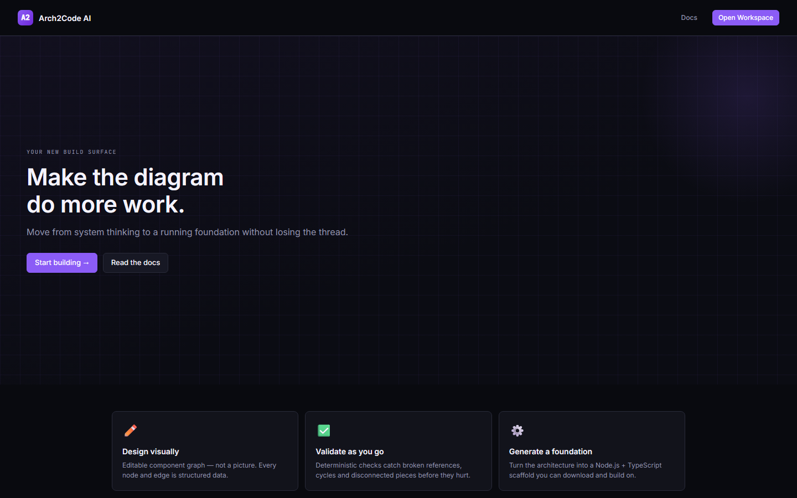
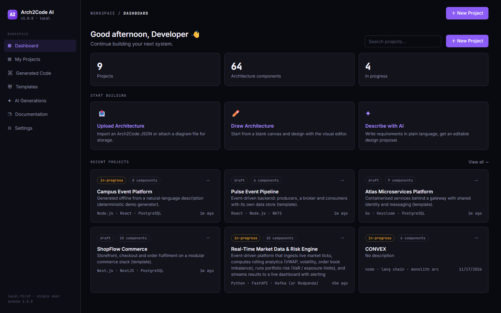
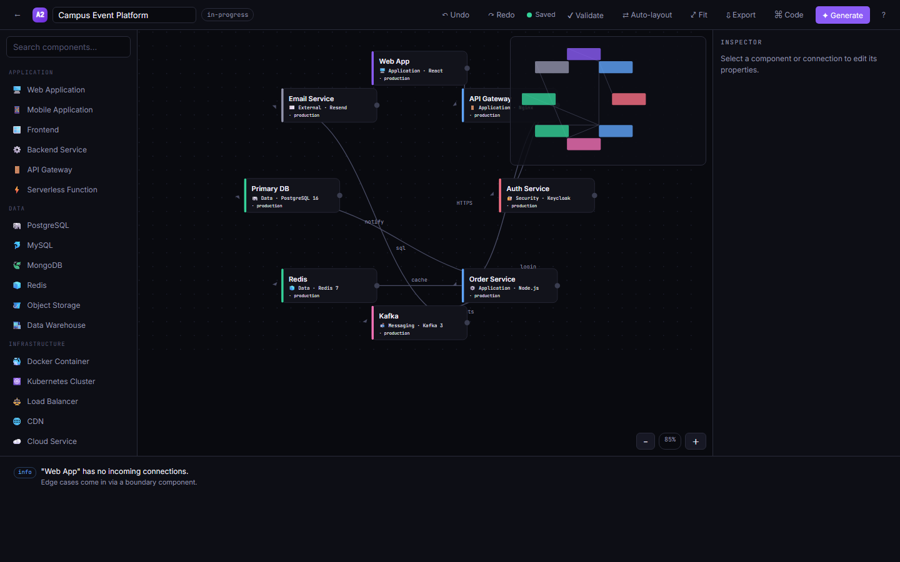
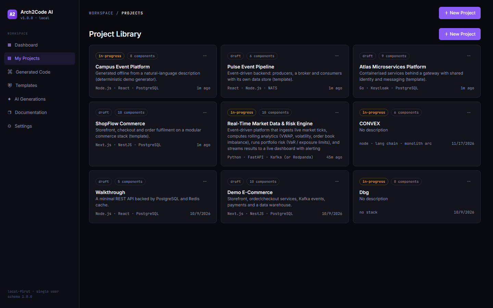
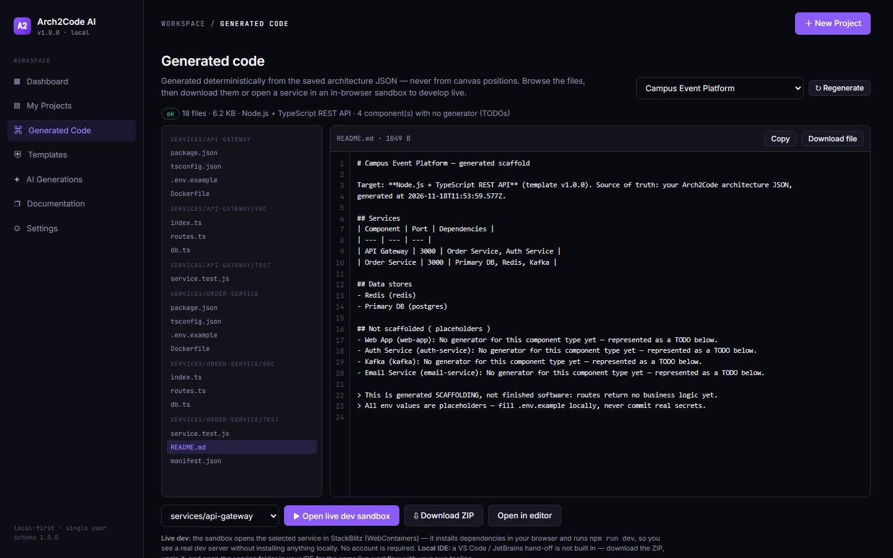

# Arch2Code AI

**Describe → Design → Validate → Generate → Export.**

A visual system-architecture platform: design editable system graphs on a canvas, validate
them with deterministic rules, generate structured architectures from natural language
(Groq LLM, server-side), and generate a Node.js + TypeScript code scaffold you can download.

**Zero runtime dependencies** — pure Node.js (>= 18) + vanilla ES modules. No install step.

---



## Run it

No install step and no configuration required — the app starts in labeled demo mode without a provider key.

```bash
npm start          # serves app + API on http://localhost:8787
npm run seed       # optional: adds 4 deterministic showcase projects (idempotent)
```

Then open **http://localhost:8787** in Chrome.

Configuration lives in `.env` (server-side only, never exposed to the browser). Copy `.env.example` to `.env` and fill in what you need:

```
GROQ_API_KEY=...           # optional; without it, generation runs in labeled demo mode
GROQ_MODEL=openai/gpt-oss-120b
DEMO_MODE=0                # 1 = force the offline demo generator even with a key
AI_FALLBACK=on             # on = provider errors fall back to a labeled demo proposal
AI_RATE_LIMIT=12           # max AI requests per IP per 5 minutes
PORT=8787
```

### Screens in this repo

| | |
|---|---|
|  |  |
| Dashboard — live stats, recent projects | Architecture editor — canvas, palette, inspector |
|  |  |
| Project library | Generated Code section |

## Tests

```bash
npm test            # 36 tests: schema/validation/codegen/zip unit tests + full API integration
npm run test:unit   # engine tests only
npm run test:api    # REST lifecycle tests only (boots its own server on a random port)
```

## What works (verified)

- **Landing & demo auth** (`/`, `/auth`) — local workspace identity; nothing is sent anywhere.
- **Dashboard** (`/dashboard`) — live stats from real data: projects, components, in-progress count; search; three creation entry points (upload / draw / describe-with-AI).
- **Projects** (`/projects`) — full library with rename, duplicate, export, delete (confirm-guarded).
- **New project** (`/projects/new`) — blank, template (7 built-ins), AI description, JSON import, image attach.
- **Architecture editor** (`/editor/:id`) —
  - left palette (26 components in 6 categories, search, click or drag onto canvas),
  - SVG canvas: pan, zoom (wheel/buttons), dot grid, select/multi-move, drag nodes,
  - connect via handle drag, select/delete edges, edge labels + relationship types,
  - right inspector edits the real graph state (name/type/tech/desc/env/port/tags/env-var names/endpoints/notes + incoming/outgoing lists),
  - undo/redo (full snapshots, 60 deep), keyboard: `Ctrl+Z / Ctrl+Shift+Z / Ctrl+S / Ctrl+D / Delete / Esc`,
  - toolbar: undo/redo/save-state dot/validate/auto-layout/fit/export/(AI) generate,
  - minimap, zoom %, collapsible issues panel bottom, per-issue click-to-focus.
- **Persistence** — one atomically-written JSON per project in `data/projects/`; corrupted files are quarantined (`.corrupt-<ts>`), never overwritten; save/reload/restart round-trips.
- **Demo safety** — if the AI provider is unreachable or rate-limited, the API returns a clearly labeled `demo-fallback` proposal instead of a 502, and the review modal says so. `DEMO_MODE=1` forces the offline generator; `AI_FALLBACK=off` restores hard failures. `npm run seed` creates showcase projects offline.
- **Security baseline** — CSP, `X-Content-Type-Options`, `X-Frame-Options: DENY`, `Referrer-Policy`, `Permissions-Policy` on every response; path-traversal-safe project ids; 4 MB body cap; per-IP rate limit on `POST /api/ai/generate` (429 + `Retry-After`).
- **REST API** — `GET /api/health`, `GET|POST /api/projects` (create from name/template, or duplicate a full archive with `duplicate: true`), `GET|PUT|DELETE /api/projects/:id`, `POST /api/projects/:id/validate`, `GET|POST /api/projects/:id/export?format=json|zip|validation-report`, `GET /api/generations`, `POST /api/ai/generate`, `GET /api/templates`. Validation errors → 4/413/422 with JSON detail.
- **Validation engine** — broken edge refs, self-connections, duplicates (ids+names), disconnected components, unreachable data stores, dependency cycles, missing tech; severities error/warning/info; click an issue → editor focuses the node.
- **AI generation** — prompt goes to `/api/ai/generate` → Groq (`json_mode`, temperature 0.2, 30s timeout, fallback model chain) → strict schema validation of every node/edge → review modal (rationale/assumptions/risks/techs, counts the model or *demo (no model)* label) → Apply/Discard. Every attempt is logged to `data/generations/` and shown in `/generations`.
- **Code generation** — deterministic Node+TS (Fastify) scaffold from the canonical graph: package.json, tsconfig, entry point with real inter-service dependency comments, routes TODO, db module, .env.example (names only), Dockerfile, smoke test, README + manifest with architecture hash. Unsupported node types are listed as explicit TODOs. Downloaded as ZIP.
- **Generated Code section** (`/code`, `/code/:projectId`) — pick a project, browse all generated files with a file tree and line numbers, copy or download a single file, download the whole ZIP. Also reachable from the editor's `⌘ Code` modal.
- **Live dev sandbox** — `Open live dev sandbox` re-roots one generated service package and POSTs it to StackBlitz WebContainers (StackBlitz's documented form POST API, no account needed). You get a real `npm run dev` server in the browser. Third-party service: the scaffold leaves this app when you click it.
- **Exports** — architecture JSON (also imports back via `/projects/new` → upload), validation report JSON, scaffold ZIP.

## Project layout

```
public/          SPA served statically (index.html, css/, js/ — app.js is the whole client)
server/js/       server.cjs (HTTP + routes + atomic storage), ai.cjs (Groq client)
shared/js/       canonical model: types, schema validator, validate engine, catalog, templates, codegen, zipwriter
data/            projects/*.json, generations/*.json (created at runtime; seeded showcase data is committed)
docs/screenshots/ README screenshots
scripts/seed.cjs demo-data seeder (idempotent, offline)
test/            unit.test.cjs, api.test.cjs
.env.example     documented environment variables
```

## Honest limitations

- Local, **single-user** file storage — not a multi-user production database; no auth (the auth page is a local demo identity).
- Diagram image upload is stored as a reference only; no picture recognition.
- Generated code is **scaffolding**, not finished business logic — read the TODOs it emits.
- Structural validation ≠ design correctness; passing validation doesn't make an architecture production-ready.
- The client app.js is a single bundled file (kept deliberately build-step-free); the server tests cover all business logic it calls.
- No local IDE integration: the app does not write scaffold files to a folder on your machine or launch VS Code/JetBrains. Use the ZIP, or the browser sandbox above, for live development.
- The AI review modal is the trust boundary: generated proposals are schema-checked but not design-reviewed. Demo/fallback proposals are deterministic templates, not model output.
  ## Future Scope
